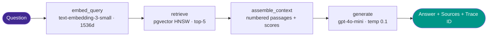

<div align="center">

<!-- ponytail: hero banner is a placeholder — drop a real 1280×320 PNG at docs/banner.png (Canva/Figma) to replace this line -->


# 🏦 Novus Bank RAG Assistant

### An honest, measured Retrieval-Augmented Generation pipeline for banking policy Q&A

*Every answer is grounded in policy. Every answer cites its source. Every run is traced.*

<br/>

[](LICENSE)
[](https://www.python.org/)
[](https://fastapi.tiangolo.com/)
[](https://github.com/pgvector/pgvector)
[](https://openai.com/)
[](https://langfuse.com/)

<br/>

[**Quick Start**](#-quick-start) · [**How It Works**](#-how-it-works) · [**Evaluation**](#-evaluation) · [**Known Weaknesses**](#-known-weaknesses) · [**Observability**](#-observability)

</div>

---

https://github.com/user-attachments/assets/89026ed3-9141-4519-b74a-f3779801b626

## 🧭 The Use Case

**Novus Bank** is a fictional Indian neo-bank with **19 policy documents** covering everything from account opening to fraud liability. Support agents field hundreds of questions daily — interest rates, fee structures, liability rules — across policies that are dense, interlinked, and full of edge cases.

This project builds a **RAG pipeline** so a support agent (or an automated system) can ask a plain-English question and get a grounded, policy-accurate answer with a **source citation** and a **LangFuse trace** for every response.

> [!NOTE]
> **The Week 1 goal is measurement, not optimization.** The point is an *honest, reproducible* baseline — so we know exactly what's broken before fixing anything in Week 2. Numbers below are real, including the ones that aren't great.

---

## ✨ Features

| | Feature | What it does |
|---|---|---|
| 🔍 | **Grounded retrieval** | pgvector HNSW cosine search over 19 policy docs, top-5 passages per query |
| 📚 | **Source citations** | Every answer names the policy document it came from |
| 🛡️ | **Input & output guardrails** | Prompt-injection gate on input; hallucination check post-generation |
| 🙈 | **PII redaction** | Anonymizer on by default (privacy-first for banking) |
| 🤝 | **Confidence + handoff** | Low-confidence queries abstain and route to a human instead of guessing |
| 📊 | **4-metric evaluation** | Hit Rate · MRR · Faithfulness · Correctness on a 72-query golden set |
| 🔁 | **Regression checker** | CI-style gate: fails if any metric drops >5pp from the saved baseline |
| 🔬 | **LangFuse tracing** | Per-query span tree with latency + token counts at every step |
| 🌐 | **FastAPI + web UI** | REST API (`/query`, `/ingest`, `/health`) with a browser front-end |

---

## 🚀 Quick Start

```bash
# 1. Start the vector database (pgvector on port 5433)
docker-compose up -d

# 2. Install dependencies
pip install -r requirements.txt

# 3. Configure — add OPENAI_API_KEY (LANGFUSE_* keys optional)
cp .env.example .env

# 4. Create the schema (once) and ingest all 19 documents
python scripts/setup_db.py
python scripts/ingest.py

# 5. Ask a question
python scripts/demo.py --query "What is my liability if I report fraud after 5 days?"
```

<details>
<summary><b>▶ Run the FastAPI server + web UI</b></summary>

```bash
uvicorn api:app --host 0.0.0.0 --port 8080 --reload
```

```bash
# Health check
curl http://localhost:8080/health

# Query with guardrails + PII redaction
curl -X POST http://localhost:8080/query \
     -H 'Content-Type: application/json' \
     -d '{"query": "What is the daily UPI limit?", "use_guardrail": true, "use_anonymizer": true}'
```

Open `http://localhost:8080/` for the browser UI.

</details>

---

## ☁️ Deploy to AWS

Both Novus projects run on ECS Fargate in **ap-south-1** and are designed to be switched **on for a demo and off afterwards**. While they are down, the only cost is image and snapshot storage.

**One-time setup**
- AWS CLI signed in (`aws login`). Docker is only needed for `--build`.
- A Secrets Manager secret `novus/dev/app-keys` in ap-south-1 with the JSON keys `OPENAI_API_KEY`, `COHERE_API_KEY` (may be empty), `LANGFUSE_PUBLIC_KEY` and `LANGFUSE_SECRET_KEY`. No key lives in this repo or in stack parameters.

**Order matters:** the Support Agent calls the RAG assistant, so the RAG assistant goes up first and comes down last.

```bash
# Up (about 20 min, then 10 min)
novus-rag-assistant/deploy/up.sh          # creates acmera-kb-dev, loads the corpus
novus-support-agent/deploy/up.sh          # creates acmera-support-dev, wired to the RAG URL

# Down (about 5 min, then 10 min)
novus-support-agent/deploy/down.sh
novus-rag-assistant/deploy/down.sh        # keeps a final RDS snapshot
```

Add `--build` to an `up.sh` to rebuild and push the image from your checkout first. Set `USE_SPOT=false` for an interview or a demo where a task must not be replaced mid-session. Fargate Spot (the default) is about 70% cheaper.

**Cost while running:** roughly $2 to $3 a day for both. The stacks have no NAT gateways: tasks sit in public subnets with a public IP for outbound API calls, while `ECSSecurityGroup` only accepts traffic from the ALB and RDS stays in private subnets.

> Stacks created before this layout (with NAT gateways) need one `down.sh` before the next `up.sh`.

---

## 🧩 How It Works



Each stage is decorated with `@observe` from LangFuse, producing a full span tree per query — with latency and token counts at every step.

<details>
<summary><b>▶ The three data-flow phases</b></summary>

```
PHASE 1 — INGEST (run once)
  corpus/*.md  →  ingest.py  →  chunks table in pgvector (port 5433)

PHASE 2 — ANSWER (per query)
  question  →  rag.ask()  →  answer + retrieved_chunks + trace_id

PHASE 3 — EVALUATE (weekly, or after any pipeline change)
  golden_dataset.json  →  eval_harness.py  →  eval_results.json + baseline_scores.json
```

</details>

---

## 📊 Evaluation

Run the full suite against the 72-query golden set:

```bash
python scripts/eval_harness.py --save-baseline
```

<div align="center">

### Overall Scorecard

| Metric | Score | |
|---|---|---|
| **Hit Rate** | `98.2%` | Is the right doc in top-5? |
| **MRR** | `0.9357` | How high does the right doc rank? |
| **Faithfulness** | `4.84 / 5.0` *(96.8%)* | Does the answer stay grounded? |
| **Correctness** | `3.93 / 5.0` *(78.6%)* | Is the answer factually right? |
| **Refusal** *(should-not-answer)* | `4.53 / 5.0` *(86.7% pass)* | Does it decline when it should? |

*72 queries — 57 answerable + 15 should-not-answer. Answerable metrics are LLM-judge scores (GPT-4o-mini @ temp 0); refusal cases scored by a separate judge with the input guardrail enabled.*

</div>

> [!WARNING]
> **Honest caveat:** the `no_answer` refusal pass-rate is only **50%** — the system still over-answers banking questions absent from the corpus instead of declining. Injection / adversarial / out-of-scope all pass 100%. Tracked for follow-up. *(Numbers vary by model version and embedding space; these are the current re-baselined figures.)*

<details>
<summary><b>▶ The golden dataset (72 queries)</b></summary>

**57 hand-written answerable queries** across all policy categories + **15 should-not-answer cases** (out_of_scope / no_answer / injection / adversarial):

| Category | Count | Sample Query |
|----------|-------|-------------|
| payments | 14 | "What is the daily UPI limit?" |
| account | 12 | "How do I reactivate a dormant account?" |
| products | 7 | "What is the FD rate for Elite senior citizens?" |
| loans | 5 | "Can I prepay my personal loan before 6 EMIs?" |
| fraud | 5 | "I shared my OTP — am I still covered?" |
| membership | 4 | "What AQB is needed for Novus Plus?" |
| grievance | 3 | "When can I go to the RBI Ombudsman?" |

Difficulty (answerable subset, n=57): ~60% easy · ~26% medium · ~14% hard. Hard queries require reasoning across multiple conditions (tier + seniority + tenure) or cover non-obvious liability edge cases.

</details>

<details>
<summary><b>▶ How each metric is computed</b></summary>

| Metric | What it measures | How computed |
|--------|-----------------|-------------|
| **Hit Rate** | Is the right doc in top-5? | `1` if expected_source in retrieved doc_ids |
| **MRR** | How high does the right doc rank? | `1/rank` if found, `0` if not in top-5 |
| **Faithfulness** | Does the answer stay grounded? | GPT-4o-mini judge, 1–5 scale, temp 0.0 |
| **Correctness** | Is the answer factually right? | GPT-4o-mini judge vs expected_answer, 1–5 |

Faithfulness and Correctness are normalized to 0–1 before aggregation, so all four metrics share one scale for the regression checker.

</details>

---

## 🐛 Known Weaknesses

These are **intentional** — the Week 1 point is to *measure* them, not hide them. Full analysis in [`scripts/failure_taxonomy.md`](scripts/failure_taxonomy.md).

1. **Boundary splits** — 500-char fixed chunking, no overlap. Answers spanning a boundary come back incomplete.
2. **Table row separation** — Markdown tables split mid-row; tier-specific numbers may land in a different chunk than their header.
3. **Multi-hop queries** — Single retrieval pass, so queries needing two documents fail.
4. **Vocabulary overlap** — "grace period" appears in 3 policies; the wrong one can rank higher.

<details>
<summary><b>▶ Week 2 fix strategy (each validated against this week's baseline)</b></summary>

1. 200-char overlapping chunks → fixes boundary splits
2. Table-aware chunking → fixes tier conflation
3. Metadata pre-filtering by policy domain → fixes vocabulary overlap
4. HyDE (Hypothetical Document Embeddings) → fixes wrong-ranking

If a change doesn't improve hit rate, it ships without that hypothesis.

</details>

---

## 🔬 Observability

With `LANGFUSE_*` keys set, every eval run posts:

- A **trace per query** with span-level latency for `embed_query`, `retrieve`, `assemble_context`, `generate`
- **Faithfulness + Correctness scores** attached to each trace
- A filterable view — *"show me all traces where correctness < 3"* → your failure cases

Without LangFuse keys, the pipeline runs identically — it just skips telemetry.

---

## 🛠️ Regression Checker

```bash
python scripts/check_regression.py                    # 5pp gate (default)
python scripts/check_regression.py --threshold 0.03   # tighter 3pp gate
```

Exits `1` if any metric drops more than the threshold from `baseline_scores.json`. Built to run in CI on every PR that touches `rag.py`, `ingest.py`, or the system prompt.

---

## ⚙️ Environment Variables

| Variable | Description |
|----------|-------------|
| `OPENAI_API_KEY` | **Required.** OpenAI API key. |
| `PG_HOST` / `PG_PORT` | Database host / port *(default: localhost / 5433)* |
| `PG_USER` / `PG_PASSWORD` / `PG_DATABASE` | Database credentials *(default: novus / novus123 / novus_kb)* |
| `LANGFUSE_PUBLIC_KEY` / `LANGFUSE_SECRET_KEY` | Optional. LangFuse project keys. |
| `LANGFUSE_HOST` | Optional. LangFuse host *(default: cloud.langfuse.com)* |

---

## 📁 Repository Structure

```
novus-rag-assistant/
├── corpus/                     # 19 Novus Bank policy documents (.md)
├── scripts/
│   ├── setup_db.py             # Create pgvector schema (run once)
│   ├── ingest.py               # Chunk + embed + store all 19 docs
│   ├── rag.py                  # Core pipeline: embed → retrieve → generate
│   ├── demo.py                 # Rich CLI for interactive Q&A
│   ├── eval_harness.py         # 4-metric eval harness
│   ├── golden_dataset.json     # 72 evaluation queries
│   ├── check_regression.py     # CI-style regression checker
│   ├── synthetic_generator.py  # Synthetic Q&A generation (3 personas)
│   ├── failure_taxonomy.md     # Analysis of failure modes
│   └── baseline_scores.json    # Saved baseline for regression checks
├── api.py                      # FastAPI wrapper (/query, /ingest, /health)
├── frontend/                   # Browser UI
├── docker-compose.yml          # pgvector on port 5433
└── requirements.txt
```

---

<div align="center">

*Built as Week 1 of AI Systems Production Engineering — the measurement foundation before optimization.*

</div>
